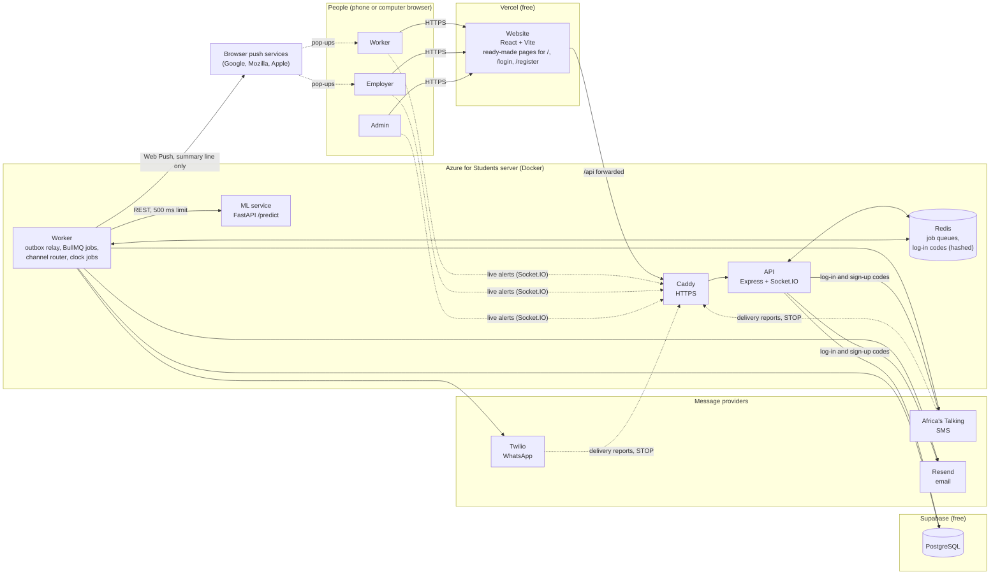
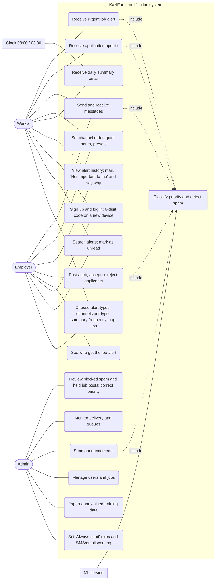
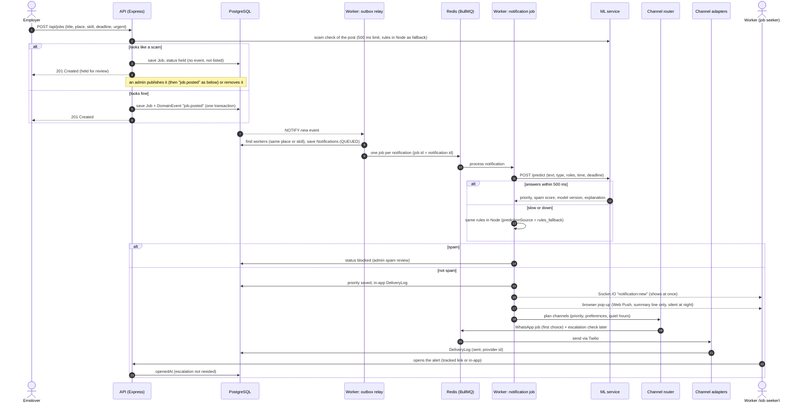
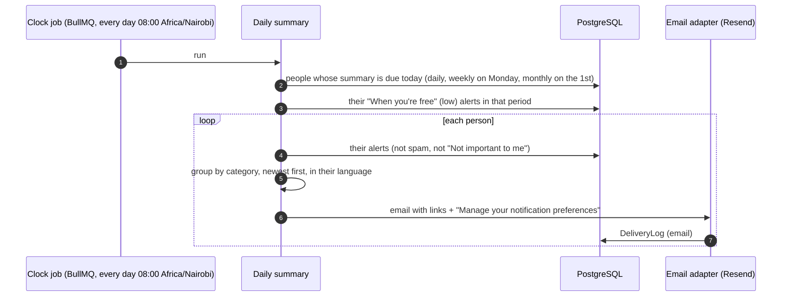
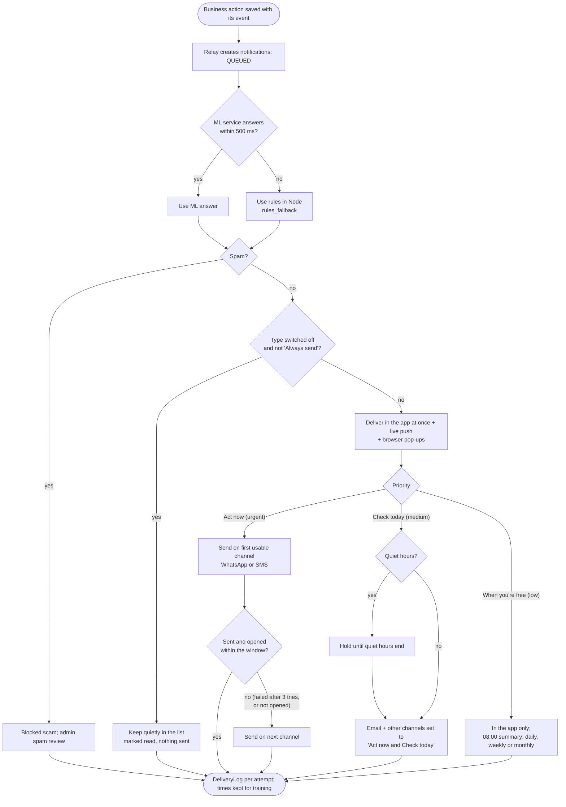
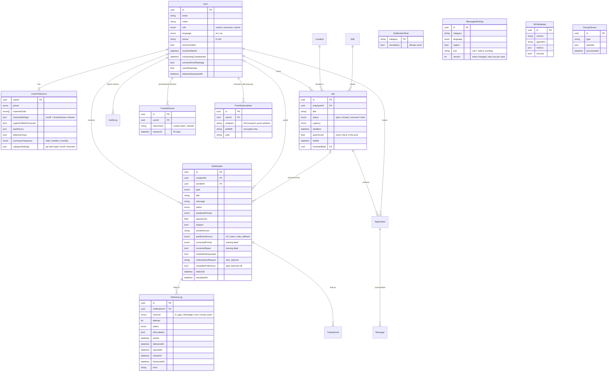
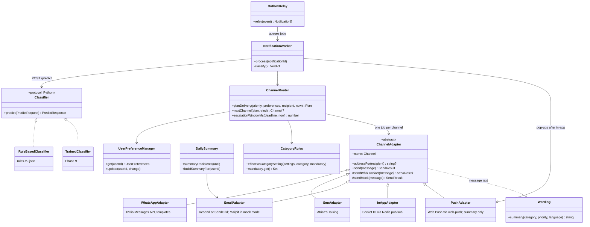
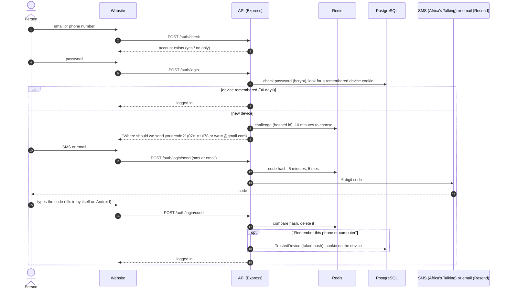
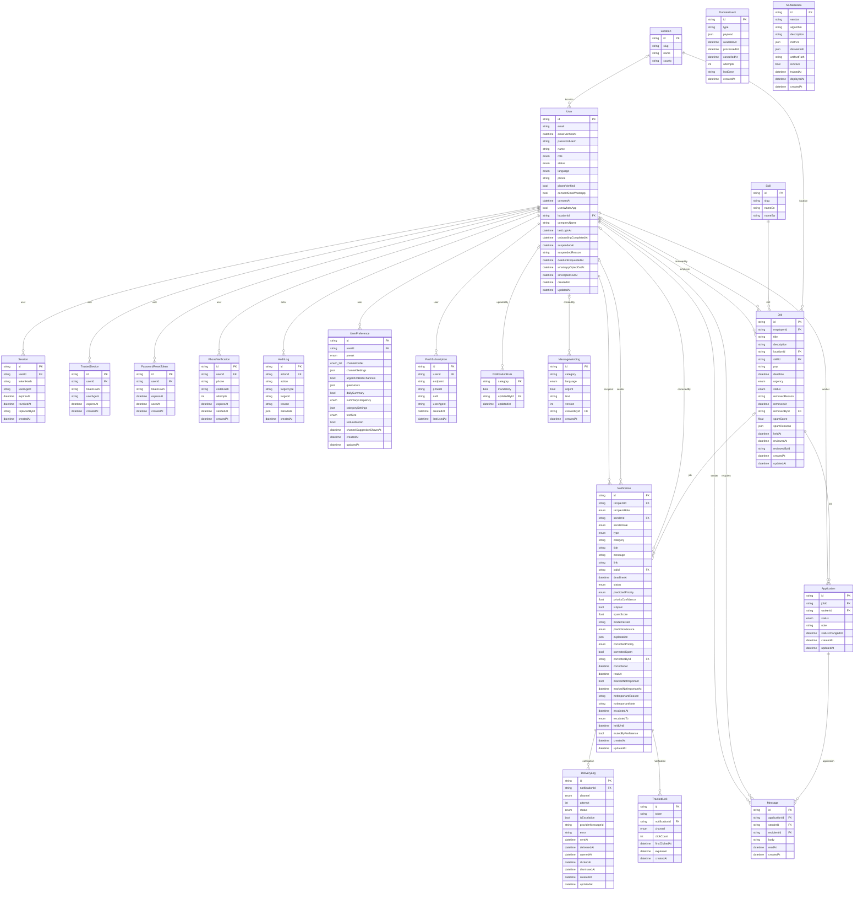

# Analysis and design diagrams (as built) — for thesis Chapter 4

These diagrams describe the system **as implemented**, updating the proposal's sections 3.5 and
3.6. They are written in Mermaid, so GitHub shows them as pictures. To put one in the Word
thesis: the pictures are ready in [diagrams/](diagrams/) (`1-architecture.png` … `9-database-schema.png`),
or open https://mermaid.live, paste the diagram's code, and use **Actions → PNG**.

Last updated 5 November 2026: log-in and sign-up codes (ADR 0013, 0015), the scam check on new
job posts, the reason behind "Not important to me", the priority names people see ("Act now",
"Check today", "When you're free", "Blocked scam"; stored as urgent, medium, low, spam), alert
types on/off and per channel, "Always send" rules, editable SMS/email wording and a weekly or
monthly summary (ADR 0016), browser pop-ups (Web Push) and the history of settings changes
(ADR 0017), and a full database schema (diagram 9).

## What changed from the proposal, and why

| Proposal (sections 3.5–3.8) | As built | Why (record) |
| --- | --- | --- |
| Urgent alerts go to **both** WhatsApp and SMS | In-app at once + the person's **first** channel; the **next** channel only if sending fails or the alert is not opened in time ("first choice, with a safety net"); "send on both" is an option | Fewer duplicate messages (less fatigue) and lower SMS cost, while urgent alerts still reach people (PRD FR-4, ADR 0006) |
| The Python service reads jobs from the BullMQ queue | The Node worker calls the Python service over REST (`POST /predict`, 500 ms limit, rules inside Node as a fallback) | One queue technology; an urgent alert never waits for, or is lost because of, the ML service (ADR 0001, 0005) |
| Notification created → queued directly | **Outbox pattern**: the business action and a `DomainEvent` are saved in one database transaction; a relay turns events into notifications | Nothing can be "done but never announced", even if the server stops at the wrong moment (ADR 0003, 0004) |
| `NotificationQueue` table | Not needed: queued work lives in Redis (BullMQ), saved to disk; the notification's `status` shows where it is | One source of truth for the queue (ADR 0004) |
| `UserPreference` = one row per channel | One row per person: channel order, per-channel on/off and threshold (JSON), quiet hours, daily summary, preset | Simpler to read and change in one go; presets first (PRD FR-5) |
| Hosting: Railway or Render, Upstash Redis | Vercel + one Azure for Students server (Docker) + Supabase | Free; Upstash's free tier cannot carry idle BullMQ traffic (ADR 0011) |
| Priority shown as "Urgent / Medium / Low" | The same three levels, shown as **Act now**, **Check today** and **When you're free** (spam: **Blocked scam**); stored as `urgent`, `medium`, `low` | Says what to do, not how the system ranks it; easier for older and first-time users (design refresh) |
| Log-in with email and password | Email **or phone number**, one question per screen; a **6-digit code** by SMS or email on a new phone or computer and at sign-up; "remember this device for 30 days" | Protects accounts whose password leaks, while a person on their own phone sees a code about once a month (ADR 0013, 0015) |
| Only notifications are checked for scams | **Job posts are checked too**, before anyone sees them: a suspicious post is held (not listed, no alerts) until an admin publishes or removes it | Stops a scam at the source instead of blocking one alert per worker; same classifier and 500 ms fallback as the alerts (ADR 0012) |
| Notifications only by in-app, WhatsApp, SMS and email | Also **browser pop-ups** (Web Push) on phones and computers that allowed them; silent during quiet hours | Alerts reach people even when the site is closed; KaziForce requirements FR-NOT-016..020 (ADR 0017) |
| Preferences per channel only | Also per **alert type** (on/off, which channels), a daily, weekly or monthly summary, and admin "Always send" rules and SMS/email wording | KaziForce requirements FR-NOT-003, 011, 031, 032, 035, 037 (ADR 0016) |
| — | Added: quiet hours with held messages, delivery reports from providers, tracked links ("opened"), "Not important to me", admin corrections, anonymised training export, account deletion after 14 days | Requirements found during the build (PRD FR-4b, FR-9, Kenya Data Protection Act) |

---

## 1. System architecture (deployment)

## 2. Use cases

## 3. Sequence: an employer posts an urgent job

## 4. Sequence: daily summary (08:00 Nairobi)

## 5. Activity: processing one notification

## 6. Entity-relationship diagram (core tables)

`MLMetadata` (model registry), `DomainEvent` (outbox), `NotificationRule` and `MessageWording`
(admin settings) stand on their own. Other tables:
`Location`, `Skill`, `Application`, `Message`, `Session`, `PasswordResetToken`,
`PhoneVerification`, `AuditLog`, `TrackedLink` ([schema.prisma](../backend/prisma/schema.prisma)).
Log-in and sign-up codes are not a table: they live in Redis for 5 minutes, hashed (ADR 0013).

## 7. Class diagram (main components)

The router and planner are plain functions in `backend/src/channels/router.ts`, shown here as one
class for readability.

## 8. Sequence: logging in on a new phone or computer (6-digit code)

Sign-up works the same way: the code goes to the email or phone the person typed (they choose,
ADR 0015), and the account is created only after the right code. With `ACCOUNT_CODES=false`
(automated tests, or while reviewing the design) the code steps are skipped.

## 9. Database schema (every table, as built)

Generated from `backend/prisma/schema.prisma` (5 November 2026): 20 tables, every
column, primary keys (PK) and foreign keys (FK). Diagram 6 shows the core tables with their
meaning; this one is the complete physical schema.

